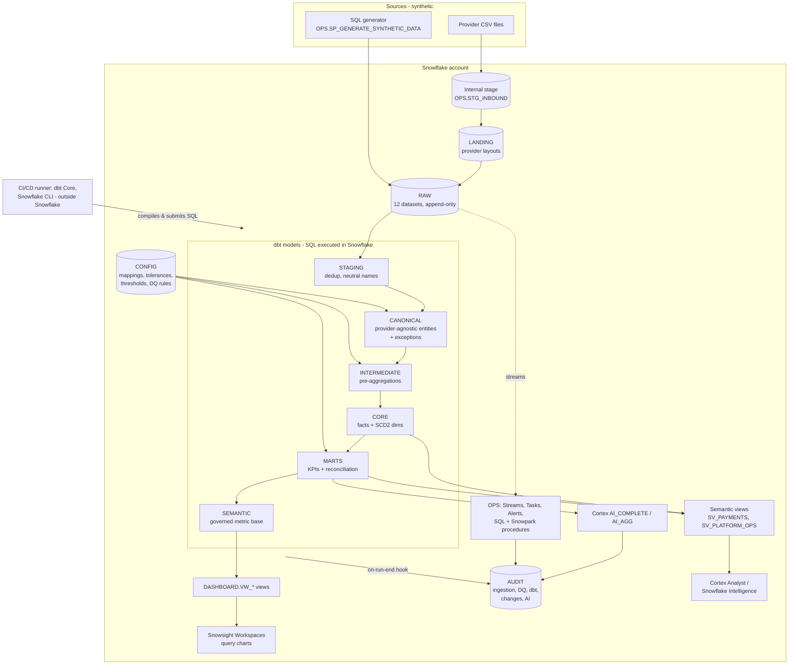
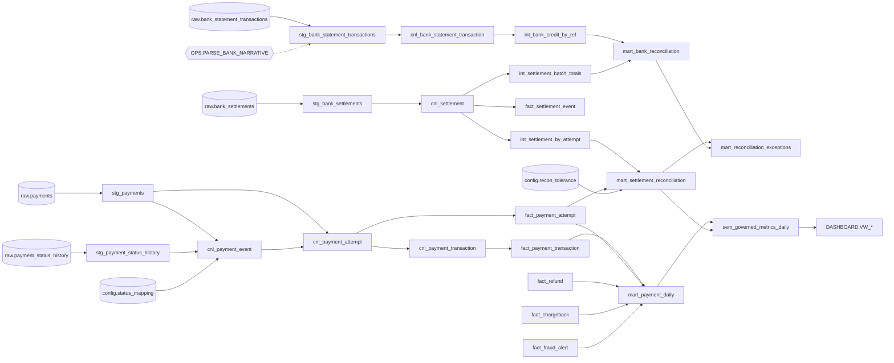

# Architecture

Analytical platform for payment analytics, settlement reconciliation and fraud monitoring.
**It is not the system of record**: it never authorises, initiates or alters a payment. All data is synthetic.

## 1. Logical architecture

## 2. Which technology does which job

| Job | Technology | Why this one (and not the others) |
|---|---|---|
| Synthetic data generation | Snowflake Scripting (SQL) | Set-based `GENERATOR` + deterministic `HASH` randomness; no Python runtime needed |
| File ingestion, header validation, rejects | `COPY INTO`, `INFER_SCHEMA`, `VALIDATE`, SQL procedure | Native bulk loading with reject capture |
| New-data detection | Append-only **Streams** on 4 RAW tables | Cheap CDC trigger; only used to start controls, not to transform |
| Scheduling of operational checks | **Tasks** (graph + finalizer) and **Alerts** | Native, serverless-friendly; `WHEN SYSTEM$STREAM_HAS_DATA` skips idle runs |
| Transformations, dependency graph, tests, docs, lineage | **dbt** (dbt-snowflake) | Version-controlled SQL, DAG, generic + singular tests; Streams/Tasks do *not* replace this |
| Canonical mapping per provider | dbt macros reading `vars.payment_providers` | Mapping is code-reviewed config; one place to onboard a provider |
| Status mapping, tolerances, fraud thresholds, DQ rules | CONFIG tables + change-request procedures | Runtime-configurable without deployment |
| Bank narrative parsing | **Snowpark Python UDF** | Ordered, configurable named-group regex patterns + date validation (awkward in SQL); SQL fallback provided |
| Generic column profiling | **Snowpark Python procedure** | Dynamic column list per table in one scan; SQL fallback provided |
| KPIs, facts, reconciliation | SQL in dbt | Ordinary relational work: SQL is clearer, cheaper, testable |
| Governed metrics for AI | **Semantic views** | Native object Cortex Analyst understands |
| Natural-language analytics | **Cortex Analyst / Snowflake Intelligence** | Generates SQL over governed metrics only |
| Exception explanations, DQ summaries | **Cortex AI_COMPLETE / AI_AGG** | Text generation; numbers come from SQL |
| Visualisation | **Snowsight Workspaces query charts** | See §4 |
| Snowpark Container Services | **Not used** | No requirement that SQL/dbt/Snowpark procedures cannot meet |

## 3. Native vs external

| Runs inside Snowflake | Runs outside Snowflake (development / deployment only) |
|---|---|
| All tables, views, semantic views, stages, procedures, UDFs, streams, tasks, alerts, policies, Cortex | **dbt Core** (compiles Jinja, submits SQL) on a laptop or CI runner |
| All compute for dbt models (SQL executes on `WH_FINTECH_TRANSFORM`) | **Snowflake CLI** / `deploy/deploy.sh` for CI deployment |
| Snowsight Workspaces charts, Cortex Analyst, Snowflake Intelligence | `snowpark/tests` unit tests and `tools/build_snowpark_sql.py` (CI only) |

dbt Core is **not** run by Snowflake in the default setup. If your account has *dbt Projects on Snowflake*,
the same project can be deployed as a dbt project object and run with `EXECUTE DBT PROJECT` from a task
(optional block in `snowflake/09_streams_tasks.sql`).

## 4. Dashboard layer: what changed in Snowsight

Snowflake removed **Legacy Dashboards** (and Legacy Worksheets) from Snowsight; new dashboard creation was
disabled on 20 April 2026 and removal began on 22 June 2026. Snowflake's official migration path is a
Streamlit app, which this project excludes by requirement. Therefore:

- There is **no tiled, non-Python dashboard canvas** in Snowsight anymore. This project does not pretend otherwise.
- Every visual is a **query chart**: each SQL file in `snowsight/` contains one query per chart with the chart
  type, axes and series documented. Snowsight renders bar, line, scatter, heat-grid and scorecard charts from query results.
- Conversational charts and answers come from **Snowflake Intelligence** over the semantic views.
- Filters are SQL session variables at the top of each file; drill-downs are separate parameterised queries.
- Reader accounts (exempt from the deprecation at the time of writing) can still use Legacy Dashboards with the same queries.

See `docs/dashboards_snowsight.md`.

## 5. Lineage (dbt)

The full, always-current lineage is `dbt docs generate` (DAG view) and `AUDIT.DBT_MODEL_LINEAGE`
(written after each `dbt run/build`, used by change-impact analysis).

## 6. Environments

One database per environment (`FINTECH_DEV`, `FINTECH_TEST`, `FINTECH_PROD`), identical schemas.
dbt targets map 1:1 (`profiles.yml.example`). SQL scripts name FINTECH_DEV explicitly;
`deploy/deploy.sh` substitutes it. Same roles across environments; grant per database.
