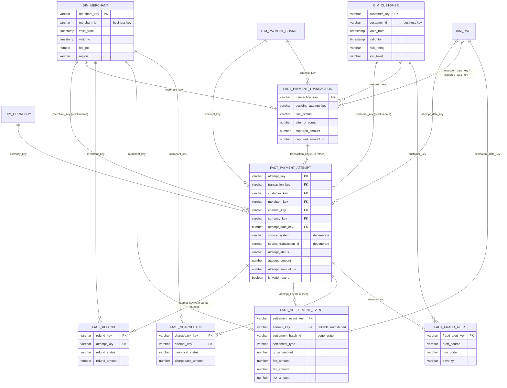

# Dimensional Model

## Facts

| Fact | Grain | PK | FKs | Measures | Degenerate dims | Load |
|---|---|---|---|---|---|---|
| FACT_PAYMENT_ATTEMPT | one provider attempt | attempt_key | transaction, customer (PIT), merchant (PIT), channel, currency, attempt_date | attempt_amount(_inr), is_success, is_failure, is_reversal | source_system, source_transaction_id, merchant_order_id, last_reason_code | incremental merge |
| FACT_PAYMENT_TRANSACTION | one merchant order (retries + providers collapsed) | transaction_key | customer, merchant (PIT at first attempt), channel, currency, transaction_date, captured_date | captured_amount(_inr), requested_amount, attempt_count, failed_attempt_count | merchant_order_id, deciding_source_transaction_id | table |
| FACT_REFUND | one refund | refund_key | attempt, transaction, customer, merchant, channel, currency, refund_date | refund_amount(_inr), is_processed | refund_id, refund_type, refund_reason | table |
| FACT_SETTLEMENT_EVENT | one settlement report line | settlement_event_key | attempt (nullable), merchant, currency, settlement_date | gross, fee, tax, net (+inr) | settlement_line_id, settlement_batch_id, settlement_type, is_final_settlement | incremental merge |
| FACT_CHARGEBACK | one chargeback (current state) | chargeback_key | attempt, transaction, customer, merchant, channel, currency, received_date | chargeback_amount(_inr), is_lost, days_open | chargeback_id, reason_code | table |
| FACT_FRAUD_ALERT | one alert (vendor or platform rule) | fraud_alert_key | attempt, customer, merchant, alert_date | alert_count, alert_score, observed_value | rule_code, alert_source, severity, status | table |

## Dimensions

| Dimension | Business key | Surrogate key | History |
|---|---|---|---|
| DIM_CUSTOMER | customer_id (+ valid_from) | md5(customer_id\|valid_from) | **SCD2** on KYC level/status, risk rating, PEP. Justified: risk reporting must use the classification valid when the payment happened. |
| DIM_MERCHANT | merchant_id (+ valid_from) | md5(merchant_id\|dbt_valid_from) | **SCD2** via `snap_merchants` (fee rate, settlement cycle, region change matter for reconciliation and row access). |
| DIM_DATE | date_day | date_key YYYYMMDD | static; Indian fiscal year columns |
| DIM_PAYMENT_CHANNEL | channel_code | md5(channel_code) | Type 1 |
| DIM_CURRENCY | currency_code | md5(currency_code) | Type 1 |

Each dimension has an **UNKNOWN member** (`md5('UNKNOWN')`); facts never drop rows for a missing dimension.

## Edge handling

| Situation | Handling |
|---|---|
| Late-arriving facts | Incremental look-back on ingestion time (default 3 days) + status resolved by event time; `--vars incremental_lookback_days` for wider backfills; `--full-refresh` always correct. |
| Late-arriving / early dimensions | First SCD2 version extended back to 1900-01-01; facts preceding the first KYC record pick the first known state. Unknown keys → UNKNOWN member, repaired the next time the fact row is reprocessed. |
| Repeated attempts | Attempt fact keeps every retry; transaction fact collapses them (attempt_count, failed_attempt_count). Success rate is transaction-level. |
| Reversals | Terminal REVERSED/VOIDED status after CAPTURED wins (latest terminal event); excluded from volume, NOT_APPLICABLE in reconciliation. |
| Multiple refunds | One row each in FACT_REFUND; summed per attempt in `int_refund_totals_by_attempt` before any comparison. |
| Multiple settlement events | One row each in FACT_SETTLEMENT_EVENT; summed per attempt in `int_settlement_by_attempt`; partial flag drives PARTIALLY_SETTLED. |

## Fan-out rule (never inflate totals)

Independent one-to-many facts (refunds, settlement lines, chargebacks, alerts) are **aggregated to the
reporting grain first** and only then joined on the grain keys (`mart_payment_daily`, `mart_merchant_performance`,
`sem_governed_metrics_daily`). Guards:

- `amount_reconciles` tests: daily mart volume = fact volume; daily refunds = fact refunds; merchant-month = daily; semantic base = marts.
- `assert_transaction_volume_not_inflated`: transaction captured value = sum of captured attempts.
- `row_count_matches`: fact rows = canonical rows.
- Verification query V07 repeats the check in Snowflake.
