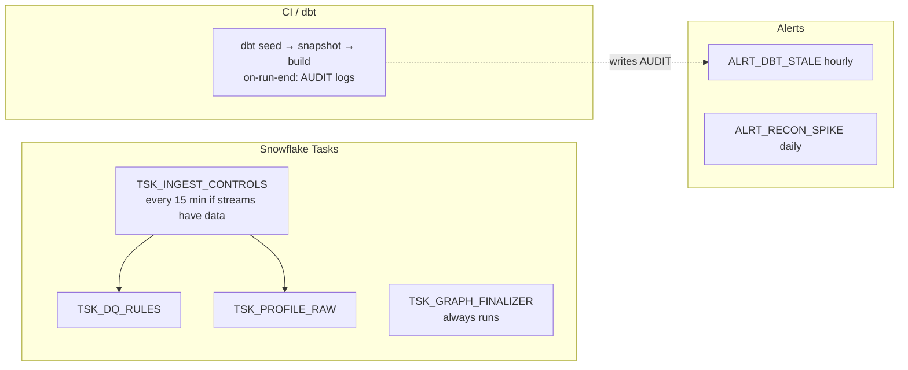

# Data Quality, Audit and Operations

## Two layers of data quality

| Layer | Tool | What | Where results go |
|---|---|---|---|
| RAW (before dbt) | `OPS.SP_RUN_DQ_RULES` driven by `CONFIG.DQ_RULE` | freshness, row-count minimum, not-null, non-negative, duplicate keys | `AUDIT.DQ_RESULTS` (RUNTIME_RULE) |
| RAW batches | `OPS.SP_RUN_INGESTION_CONTROLS` | arrivals per batch (from streams), row counts, control totals, duplicate deliveries | `AUDIT.RAW_ARRIVALS`, `CONTROL_TOTALS`, `DUPLICATE_LOG` |
| Files | `OPS.SP_LOAD_STAGE_PATH` | header contract (`CONFIG.FILE_CONTRACT`), COPY rejects | `AUDIT.INGESTION_LOG`, `INGESTION_REJECTS` |
| Integration | dbt model `cnl_exceptions` | unknown status/provider/channel, invalid amount/currency/timestamp, orphans, refunds > capture | `CANONICAL.CNL_EXCEPTIONS` |
| Transformations | dbt tests (generic + singular) | keys, FKs, accepted values, SCD2 windows, control totals, fan-out guards, known answers | `DQ_FAILURES.*`, `AUDIT.DBT_RUN_RESULTS`, `AUDIT.DQ_RESULTS` (DBT_TEST) |
| Reconciliation | marts | exceptions with category/severity/age | `MARTS.MART_RECONCILIATION_EXCEPTIONS` |

`DASHBOARD.VW_DATA_QUALITY_STATUS` merges them into one board.

Coverage of the required checks: null & unique keys (YAML tests), referential integrity (`relationships`),
status validation (`canonical_status_valid`, UNKNOWN_STATUS), duplicate events (hash dedup + DUPLICATE_LOG +
DEDUP_COUNT known answer), currency & amount (`non_negative`, INVALID_CURRENCY/AMOUNT), freshness (`dbt source freshness`,
FRESHNESS_HOURS rules, `ALRT_DBT_STALE`), source-to-target control totals (`amount_reconciles`,
`assert_raw_to_canonical_attempt_control`, V03/V04), reconciliation exceptions (marts), execution audit logs
(AUDIT schema), task monitoring (task history queries, finalizer), failure notification (finalizer + optional email integration, alerts).

## Orchestration

Tasks handle *operational* work; dbt owns the transformation DAG and tests. The two meet only through AUDIT
tables (dbt writes run results; alerts read them). Optional: run dbt from a task with `EXECUTE DBT PROJECT` if
dbt Projects on Snowflake is available.

**Retries & recovery:** root task `TASK_AUTO_RETRY_ATTEMPTS = 2`, `SUSPEND_TASK_AFTER_NUM_FAILURES = 3`,
30-minute timeout. Procedures are idempotent (controls process only uncontrolled batches; stream offsets move
only on commit; generator truncates when `p_reset`). Manual rerun: `EXECUTE TASK OPS.TSK_INGEST_CONTROLS;`.
dbt failures: fix, then `dbt retry` or `dbt build -s result:error+ --state target/`.
Resume after auto-suspend: `ALTER TASK OPS.TSK_INGEST_CONTROLS RESUME;` (children first if recreated).

**Monitoring:** `DASHBOARD.VW_PIPELINE_EXECUTION_STATUS`; task history and graph queries at the end of
`09_streams_tasks.sql`; `ALERT_HISTORY()`; `SHOW STREAMS` (`stale_after`).

## Audit trail

| Table | Content |
|---|---|
| INGESTION_LOG / INGESTION_REJECTS | every load, rows loaded/rejected, rejected record text |
| CONTROL_TOTALS | per-batch counts and amounts; generator truth for reconciliation of the pipeline |
| PROCEDURE_LOG | every procedure step with query id, user, status |
| DQ_RESULTS | runtime rules + dbt tests |
| DBT_RUN_RESULTS / DBT_MODEL_LINEAGE | every dbt node result; DAG edges |
| CHANGE_LOG / KPI_SNAPSHOT | configuration changes with before/after KPIs |
| CORTEX_USAGE_LOG / AI_EXCEPTION_EXPLANATION | AI usage and outputs |
| ACCOUNT_USAGE.ACCESS_HISTORY | who read which columns (query in 10_security_governance.sql) |
