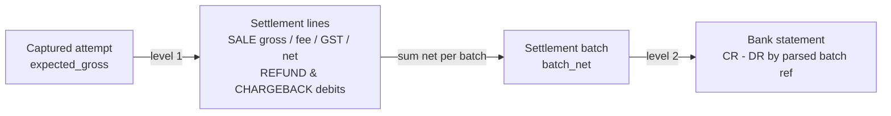

# Financial Reconciliation

Two levels, each with explicit formulas. Gross payment volume is **never** compared with bank credits:
MDR fees, GST on fees, refund debits and chargeback debits make them legitimately different
(verification query V08 shows the bridge).

## Level 1 — payment ↔ settlement (`MARTS.MART_SETTLEMENT_RECONCILIATION`)

| Term | Formula |
|---|---|
| expected_gross | attempt_amount if attempt_status = CAPTURED else 0 |
| settled_gross | Σ gross_amount of SALE lines for the attempt (all batches) |
| gross_difference | expected_gross − settled_gross |
| applied_tolerance | max(abs_tolerance, expected_gross × pct_tolerance) — `CONFIG.RECON_TOLERANCE` (PAYMENT_SETTLEMENT, by currency) |
| expected_settlement_date | captured_date_ist + merchant.settlement_cycle_days |
| expected_fee / expected_net | round(gross × fee_pct, 2); gross − fee − round(fee × 0.18, 2) |
| fee variance | \|sale_fee / settled_gross − contracted fee_pct\| > fee_variance_pct |
| outstanding_gross | max(expected_gross − settled_gross, 0) |
| timing difference | first SALE settlement date > expected date (still MATCHED if amounts agree) |

Matching key: `canonical_attempt_id` = md5(source_system | source_transaction_id) on both sides.

Status (first match wins): NOT_APPLICABLE → SETTLED_NOT_CAPTURED → PENDING_SETTLEMENT (no lines, within
expected date + grace) → UNSETTLED → MATCHED → PARTIALLY_SETTLED (short and provider flagged a non-final
line) → OVER_SETTLED → AMOUNT_MISMATCH.

Refund and chargeback debits are carried on the row (`refund_net_settled`, `chargeback_net_settled`) but do not
change the sale match; they reconcile at level 2.

## Level 2 — settlement batch ↔ bank (`MARTS.MART_BANK_RECONCILIATION`)

| Term | Formula |
|---|---|
| batch_net_amount | Σ net_amount of all lines in the batch (SALE net of fee & GST, minus REFUND and CHARGEBACK) |
| bank_net_amount | Σ CR − Σ DR of bank lines whose narrative parses to the batch id |
| difference | batch_net − bank_net |

Matching key: `settlement_batch_id` = parsed reference from the bank narrative
(`OPS.PARSE_BANK_NARRATIVE`, patterns in `CONFIG.BANK_NARRATIVE_PATTERN`) + currency.

Status: UNMATCHED_BANK_CREDIT (ref with no batch) → PENDING_BANK_CREDIT (no bank line, within grace) →
MISSING_BANK_CREDIT → MATCHED (\|difference\| ≤ abs_tolerance BATCH_BANK) → AMOUNT_MISMATCH.

## Exceptions (`MARTS.MART_RECONCILIATION_EXCEPTIONS`)

Every non-matched, non-pending item, plus orphan settlement lines (UNMATCHED_SETTLEMENT), fee variances and
bank entries without a settlement reference (UNIDENTIFIED_BANK_ENTRY). Each row carries category, type,
severity, amount, age bucket and the source keys to trace back to RAW (verification V10).
Drill-down path: `snowsight/04_settlement_reconciliation.sql` [S5] and [S6].

## Known synthetic test cases (`snowflake/05_edge_cases.sql`)

Merchant M_EDGE: fee 2.00%, GST 18% on fee, T+1. Expectations are stored in `CONFIG.EXPECTED_TEST_OUTCOME`
and enforced by dbt test `assert_edge_case_expected_outcomes`.

| Case | Scenario | Expected |
|---|---|---|
| E01 | PROV_A EDGE-A-0001 delivered twice | 1 canonical attempt; MATCHED |
| E02 | 3 attempts (2 declined, 1 captured) on one order | attempt_count 3; CAPTURED; capturing attempt MATCHED |
| E03 | PROV_C delivered pending; captured event arrives a day late; older pending event arrives later still | final CAPTURED; MATCHED |
| E04 | 10,000 captured, two partial refunds 3,000 + 2,000 | refunds 5,000.00; sale MATCHED |
| E05 | Settlement line for unknown payment EDGE-B-9999 (750) | UNMATCHED_SETTLEMENT |
| E06 | Captured 2026-04-05, never settled | UNSETTLED (outstanding 1,200) |
| E07 | Captured 4,000, settled 3,900 | AMOUNT_MISMATCH (diff 100 > tolerance 1.00) |
| E08 | Captured 8,000, lost chargeback 8,000 | sale MATCHED; chargeback 8,000.00 |
| E09 | KYC MIN/LOW → FULL/LOW → ENHANCED/HIGH | 3 SCD2 versions; current HIGH |
| E10 | amount −50; currency XXX; status ZZ | INVALID_AMOUNT; INVALID_CURRENCY; UNKNOWN_STATUS |
| E11 | Captured then reversed | final REVERSED; NOT_APPLICABLE |
| E12 | 6,000 settled as 4,000 (non-final) + 2,000 in next batch; second 6,000 only 4,000 non-final | MATCHED; PARTIALLY_SETTLED |
| E13 | Batch SB-PE-20260411 credited exactly; SB-PE-20260412 never credited; bank ref SB-PE-20260413 unknown | MATCHED; MISSING_BANK_CREDIT; UNMATCHED_BANK_CREDIT |
| E14 | PROV_C uses the same id EDGE-A-0001 as PROV_A | distinct attempt; MATCHED |

Batch SB-PE-20260411 (13 lines): gross SALE 84,950.00 − fees & GST 2,004.82 − refunds 5,000.00 − chargeback 8,000.00 = **net 69,945.18**,
credited exactly by BST-EDGE-1. SB-PE-20260412 net = 2,000 − 40.00 − 7.20 = **1,952.80**, never credited.

## Generated population (default generator run)

Designed rates (deterministic per seed): ~2% of captured attempts unsettled, ~0.5% two-part partial settlements,
~0.5% partial-only, ~0.5% short-settled, ~1% batches missing a bank credit, ~1% batches with a 25.00 bank
charge (BATCH_AMOUNT_MISMATCH), ~5% batches credited a day late (timing difference only), monthly
interest/charge entries (UNIDENTIFIED_BANK_ENTRY).
